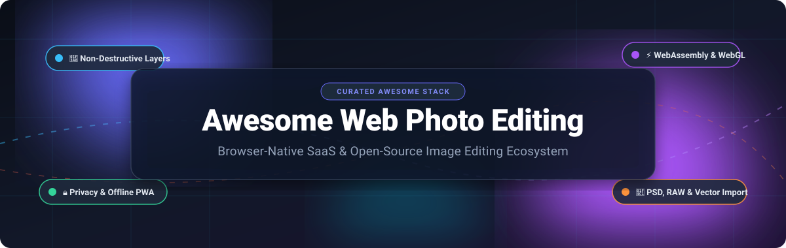
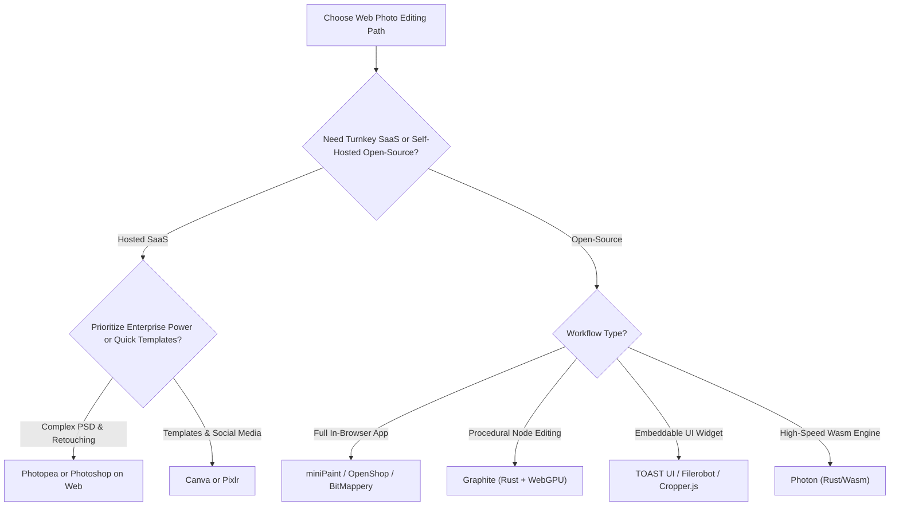

  

  
  
  
  
  
  
  

# 📸 Awesome Web Photo Editing Software 🎨

> **A curated showcase of premier browser-based photo editing SaaS applications and open-source GitHub projects. Engineered for browser-native raster manipulation, non-destructive layer editing, client-side WebAssembly rendering, offline PWAs, and zero-telemetry self-hosting.**

---

## 📑 Table of Contents
- [🔍 Overview & SEO Highlights](#-overview--seo-highlights)
- [🌐 Sector Overview & Market Dynamics](#-sector-overview--market-dynamics)
- [☁️ SaaS & Hosted Web Photo Editors](#️-saas--hosted-web-photo-editors)
- [💻 Open-Source GitHub Projects](#-open-source-github-projects)
- [🛠️ Key Selection & Architecture Guide](#️-key-selection--architecture-guide)
- [🤝 How to Contribute](#-how-to-contribute)
- [📈 Star History](#-star-history)
- [💖 Support & Sponsoring](#-support--sponsoring)
- [⚖️ Disclaimer & License](#️-disclaimer--license)

---

## 🔍 Overview & SEO Highlights

Web photo editing software enables graphics professionals, photographers, and developers to create, retouch, and composite raster imagery directly within modern web browsers without installing native desktop software. Powered by **HTML5 Canvas**, **WebGL**, **WebGPU**, and **WebAssembly (WASM)**, modern browser photo editors deliver Photoshop-grade workflows:

- 🗂️ **Non-Destructive Layer Pipelines**: Adjustment layers, blend modes, masks, and smart object support.
- ⚡ **Local-First Execution**: In-browser client-side image processing keeping files strictly on device.
- 🖼️ **Multi-Format Compatibility**: Native PSD, RAW (.CR2, .NEF, .DNG), OpenRaster, WebP, AVIF, and SVG import/export.
- 🤖 **On-Device Web AI**: Browser-based neural models for background removal, upscaling, depth estimation, and smart segmentations.
- 🔒 **Privacy & Self-Hosting**: Offline-ready Progressive Web Apps (PWAs) and Dockerized deployments with zero server telemetry.

---

## 🌐 Sector Overview & Market Dynamics

The global photo editing software market is valued at approximately **$1.20 billion to $2.50 billion**, expanding to over **$18 billion** when factoring in the broader digital imaging ecosystem and cloud creative services, charting a Compound Annual Growth Rate (CAGR) of **8.6% to 9.3%**.

The sector exhibits **moderate fragmentation with strong top-tier concentration (winner-takes-most dynamics)**:
- **Enterprise & Suite Dominance**: Established giants like **Adobe** and collaborative platforms like **Canva** control the lion's share of enterprise design budgets, marketing asset generation, and commercial workflows.
- **Mid-Tier & Utility Competitiveness**: Independent cloud suites (**Pixlr**, **Fotor**, **BeFunky**) and indie browser tools (**Photopea**) fiercely compete for prosumer, freelance, and ad-supported traffic by offering instant browser access without heavyweight desktop installations.
- **Open-Source & Privacy Frontier**: A growing developer and self-hosted movement is breaking vendor lock-in through local-first WebAssembly engines and single-HTML offline editors that require zero subscriptions and preserve absolute data privacy.

---

## ☁️ SaaS & Hosted Web Photo Editors

The table below catalogs leading hosted and cloud-native photo editing platforms, sorted in descending order by company scale (market valuation / ARR).

| 🏢 Platform | 📊 Company Valuation / ARR | 💵 Pricing (Starting Paid Tier) | 🎁 Free Tier Limit | 🌟 Core Capabilities & Best For |
|:---|:---|:---|:---|:---|
| **[Adobe Photoshop on Web](https://www.adobe.com/products/photoshop/online.html)** | **~$195 Billion Market Cap** (~$21.5B ARR) | **$9.99/month** (Photography Plan) or **$22.99/month** (Photoshop Standalone) | **7-day free trial** with full Photoshop Web features; no permanent free tier (Adobe ID required) | Full desktop PSD interchange, Firefly Generative AI, cloud document sync, neural filters, and precision masking. Best for creative enterprise pros. |
| **[Canva](https://www.canva.com/)** | **~$32 Billion Valuation** (~$2.3B ARR) | **$14.99/month** (or **$119.99/year** single user Pro) | **Free forever**: 5GB cloud storage, 1M+ free stock assets & templates, 1,000+ fonts, basic drag-and-drop photo editor (AI background remover & brand kits locked) | Template-first rapid layout design, one-click magic erase, team collaboration, and social publishing. Best for marketers and casual creators. |
| **[Pixlr](https://pixlr.com/)** | **~$50M – $100M Revenue** (Inmagine Group) | **$1.99/month** (Pixlr Plus) or **$7.99/month** (Pixlr Premium) | **Free forever**: Ad-supported, 3 daily AI generation saves, basic layers, max resolution up to 4K | Dual interface (Pixlr X for quick edits, Pixlr E for advanced layers), AI cutout tools, and WebGL filters. Best for speedy browser retouching. |
| **[Fotor](https://www.fotor.com/)** | **~$20M – $30M ARR** (Everimaging) | **$8.99/month** (or **$3.33/month** billed annually at $39.99/year) | **Free forever**: 500MB cloud storage, standard adjustments and collage layouts; watermarked premium AI exports, ad-supported | Batch photo processing, AI portrait retouching, 1-tap HDR enhancement, and beauty touch-ups. Best for automated portrait retouching. |
| **[BeFunky](https://www.befunky.com/)** | **~$10M – $20M ARR** (Privately held) | **$14.99/month** (or **$6.99/month** billed annually at $83.88/year) | **Free forever**: 125 basic digital effects, basic cropping, exposure, and collage grid; batch editing & AI cutout locked, ad-supported | Creative photo effects (Artsy, Cartoonizer), graphic designer modules, and simple collage layouts. Best for artistic hobbyist filters. |
| **[Polarr](https://www.polarr.com/)** | **~$5M – $10M ARR** | **$7.99/month** (or **$3.99/month** billed annually at $47.99/year) | **Free forever**: Global adjustments (exposure, temp, tint, contrast), standard HSL, and 1 custom filter export per day | Advanced color curves, dual-tone toning, custom QR filter presets, and selective brush/radial masks. Best for mobile/web colorists. |
| **[Photopea](https://www.photopea.com/)** | **~$1.5M – $2.5M ARR** (Bootstrapped Indie) | **$5.00/month** (or **$15/3-months**, **$50/year** single user) | **Free forever**: 100% full feature access to all layers, masks, smart objects, and PSD export; side banner ads, 30 undo steps (vs 60), 0.5GB Peadrive | Near-complete web Photoshop replica, native PSD/XCF/Sketch/RAW reading, layer styles, and vector paths. Best for subscription-free Photoshop parity. |

---

## 💻 Open-Source GitHub Projects

Curated open-source browser photo editors, canvas drawing suites, and WebAssembly image processing libraries, **sorted in descending order by GitHub stargazers count**.

| 📦 Repository | ⭐ GitHub_Stars | 📜 License | 🛠️ Tech Stack | 🎯 Focus Area |
|:---|:---:|:---:|:---|:---|
| **[Graphite](https://github.com/GraphiteEditor/Graphite)** |  | Apache-2.0 | Rust, WebAssembly, WebGPU, Vue | Procedural node-based 2D graphics & non-destructive photo editor suite |
| **[Cropper.js](https://github.com/fengyuanchen/cropperjs)** |  | MIT | JavaScript, HTML5 Canvas | Battle-tested image cropping, rotating, scaling, and canvas transformation |
| **[JS Paint](https://github.com/1j01/jspaint)** |  | MIT | JavaScript, HTML5, PWA | Classic MS Paint remastered with modern layer support, transparency, and GIF animations |
| **[TOAST UI Image Editor](https://github.com/nhn/tui.image-editor)** |  | MIT | JavaScript, HTML5 Canvas | Comprehensive component editor with cropping, rotation, filters, masks, and drawing |
| **[Photon](https://github.com/silvia-odwyer/photon)** |  | Apache-2.0 | Rust, WebAssembly | Blazing-fast WebAssembly image manipulation engine for real-time web filters and color grading |
| **[miniPaint](https://github.com/viliusle/miniPaint)** |  | MIT | JavaScript, HTML5 Canvas | Offline-capable, zero-upload photo editor with layers, blend modes, and Instagram-style filters |
| **[Filerobot Image Editor](https://github.com/scaleflex/filerobot-image-editor)** |  | MIT | React, TypeScript | Embeddable responsive image editor widget with fine-tuning, annotations, and watermarks |
| **[DarkroomJS](https://github.com/MattKetmo/darkroomjs)** |  | MIT | JavaScript, Fabric.js | Extensible browser image editing module with non-destructive history and crop tools |
| **[Fabritor](https://github.com/sleepy-zone/fabritor-web)** |  | MIT | React, TypeScript, Fabric.js | Creative photo and poster designer supporting templates, text styling, and social graphics |
| **[Klecks](https://github.com/bitbof/klecks)** |  | MIT | TypeScript, HTML5 Canvas | Browser painting & photo editing tool powering Kleki.com with pressure sensitivity & layers |
| **[BitMappery](https://github.com/igorski/bitmappery)** |  | MIT | TypeScript, Vue, Canvas | Self-hosted pixel and photo editor with non-destructive layers, polygonal lasso, and Docker support |
| **[Canva Clone (LidoJS)](https://github.com/lidojs/canva-clone)** |  | MIT | React, TypeScript | Drag-and-drop visual design and image editing platform for banners and social assets |
| **[OpenShop](https://github.com/SysAdminDoc/Openshop)** |  | GPL-3.0 | HTML5, JavaScript, Wasm AI | Local-first Photoshop alternative with PSD support, smart objects, pixel selections, and local AI |

---

### 🔬 Deep Dive: Highlighted Open-Source Projects

#### 1. [Graphite](https://github.com/GraphiteEditor/Graphite)
- **Overview**: An ambitious 2D procedural graphics and photo editor built in Rust and WebAssembly, accelerated with WebGPU via `wgpu`.
- **Highlights**: Node graph architecture allows infinite non-destructive compositing, procedural vector fills, and raster effects.
- **Best For**: Designers seeking a modern, future-proof, procedural alternative to traditional layer-stack editors.

#### 2. [miniPaint](https://github.com/viliusle/miniPaint)
- **Overview**: A lightweight, client-side raster photo editor that requires zero installation, registration, or cloud transmission.
- **Highlights**: Full multi-layer stack, blending modes, color correction curves, vintage filters, and JSON layer project export.
- **Best For**: Web developers needing a plug-and-play static editor they can host on GitHub Pages or an internal intranet.

#### 3. [TOAST UI Image Editor](https://github.com/nhn/tui.image-editor)
- **Overview**: A battle-tested canvas-based image editor developed by NHN Cloud, ideal for embedding into enterprise web dashboards.
- **Highlights**: Rich UI out of the box, text placement, icon stamping, color balance, crop presets, and fine rotation controls.
- **Best For**: Integration into CMSs, customer support portals, and administrative back-offices.

#### 4. [OpenShop](https://github.com/SysAdminDoc/Openshop)
- **Overview**: A single-HTML / offline PWA photo editor designed specifically as an open-source, telemetry-free Photoshop alternative.
- **Highlights**: Loads and exports native PSDs, adjustment layers, embedded Smart Objects, and includes in-browser AI segmentation.
- **Best For**: Power users wanting Photoshop fidelity without cloud accounts or subscriptions.

---

## 🛠️ Key Selection & Architecture Guide

---

## 🤝 How to Contribute

Contributions are warmly welcomed! Help keep this ecosystem reference up-to-date:

1. 🍴 **Fork the repository** on GitHub.
2. 🌿 **Create a descriptive branch** (`git checkout -b add-my-editor`).
3. 📝 **Add or update entries** following existing markdown table guidelines:
   - Provide exact pricing numbers for SaaS products (no generic terms).
   - Specify concrete free tier/trial limits.
   - For open-source repos, include social badge links to the repository's `stargazers` page.
4. 🚀 **Submit a Pull Request** with a concise summary of your changes.

---

## 📈 Star History

---

## 💖 Support & Sponsoring

If you find this curated collection of web photo editing software valuable for your projects and research, please consider showing your support:

- ⭐ **Star this repository** to boost visibility for the community
- 🍴 **Fork and share** with colleagues, designers, and web developers
- ☕ **Sponsor the Maintainer**: Buy a coffee or become a recurring sponsor via the [GitHub Sponsors Dashboard](https://github.com/sponsors/ishandutta2007)

Thank you for championing open, client-side, and accessible creative tools! 🌟

---

## ⚖️ Disclaimer & License

- **Disclaimer**: This repository is a community-curated directory. Brand names, logos, and trademarks belong to their respective copyright holders. Pricing, tier limits, and valuations reflect public records and are subject to change by vendors.
- **Awesome Lists**: Part of the curated ecosystem at [Awesome-Awesome-Awesome](https://github.com/ishandutta2007/Awesome-Awesome-Awesome).
- **License**: Released under the [MIT License](LICENSE).
